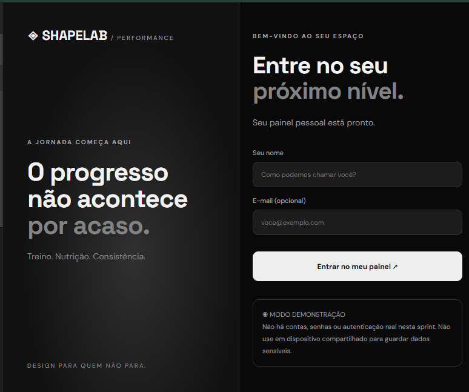
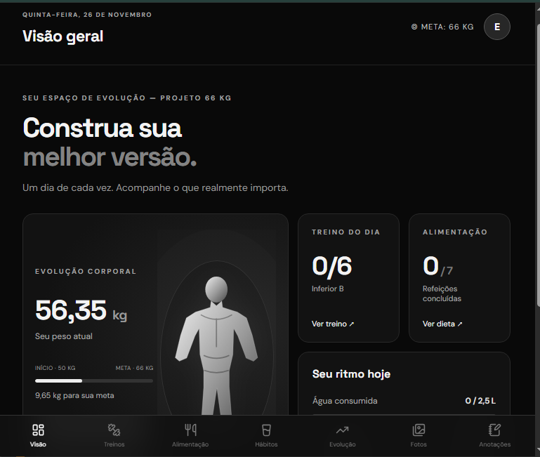
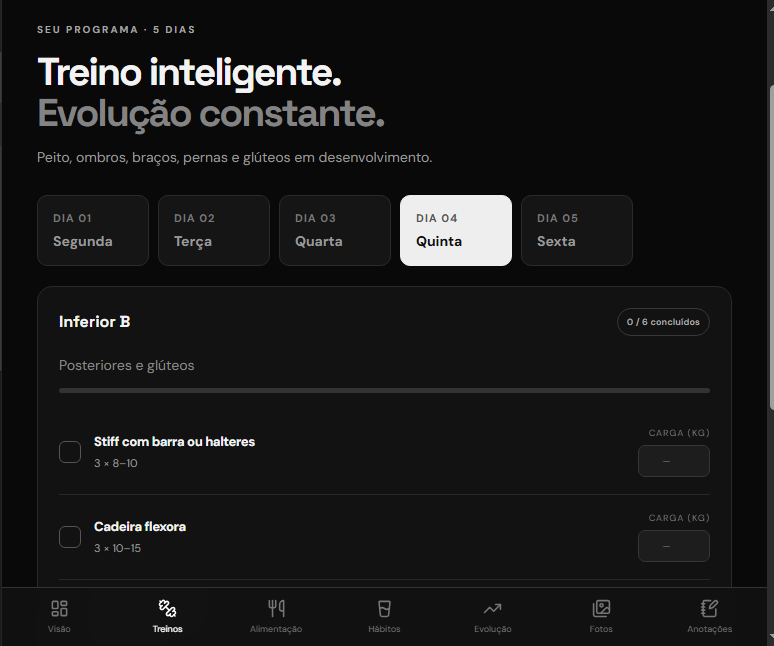
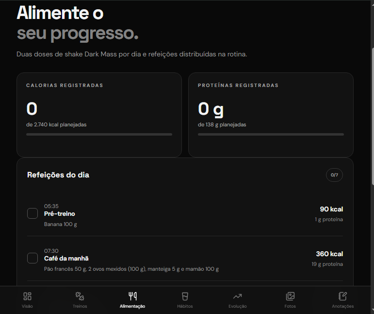
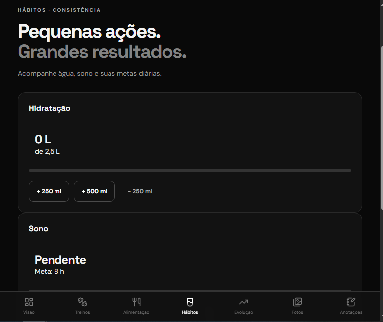
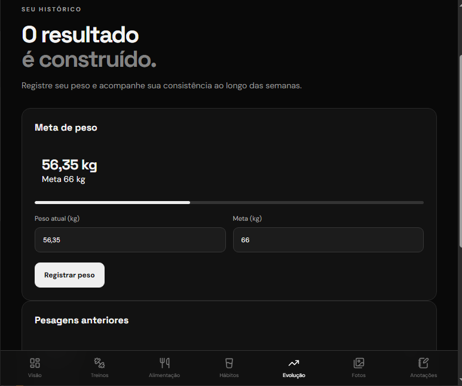
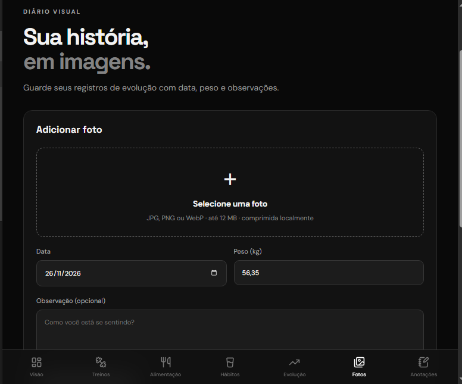
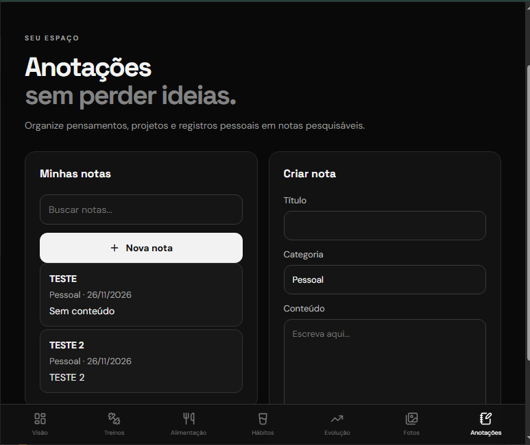

<div align="center">

# SHAPELAB

### Seu progresso. Sua rotina. Sua evolução.

**Plataforma de acompanhamento pessoal de treinos, alimentação e evolução física.**


</div>

---

## Sobre o projeto

O **ShapeLab** nasceu da ideia de reunir, em um único lugar, as informações essenciais para acompanhar uma jornada de evolução física: **treinos, alimentação, hidratação, sono, peso, fotografias e anotações**.

Em vez de depender de várias planilhas ou aplicativos separados, o usuário encontra um painel centralizado para registrar o que realizou e observar sua consistência ao longo do tempo.

A interface segue a abordagem **mobile first**, com visual **dark minimalista**, contraste em preto, branco e cinza e navegação simplificada. O projeto também funciona como uma iniciativa de aprendizado e evolução contínua em desenvolvimento web, arquitetura modular e construção de APIs.

> **Status:** versão web em evolução. Algumas funcionalidades utilizam armazenamento local e o acesso demonstrativo não equivale a autenticação real. A estrutura de backend está sendo desenvolvida gradualmente.

## Objetivo

Criar uma experiência prática e intuitiva que ajude o usuário a:

- Organizar e acompanhar sua rotina de exercícios.
- Monitorar o cumprimento do plano alimentar.
- Registrar o consumo de água e as horas de sono.
- Visualizar a evolução do peso e das metas pessoais.
- Construir um histórico fotográfico da evolução física.
- Guardar anotações relacionadas à sua jornada.

**Visão de longo prazo:** transformar o ShapeLab em uma plataforma multiusuário, com contas individuais, treinos e dietas editáveis, sincronização segura de dados e aplicativos para **Android e iOS**.

---

## Conheça a interface

### 1. Acesso ao ShapeLab

Tela de entrada com a identidade visual do produto e uma experiência inicial de acesso. Na versão demonstrativa, o formulário não representa autenticação segura de usuários.



### 2. Dashboard — visão geral

Painel com o peso atual, a meta definida, uma representação **ilustrativa** da evolução corporal e atalhos para o treino, alimentação e hábitos do dia.



> A silhueta é uma visualização simbólica do progresso registrado, não uma previsão da aparência corporal nem uma medida de composição física.

### 3. Treinos

Organização do programa semanal por dias, com exercícios, séries, intervalos de repetições, campos para cargas e acompanhamento dos exercícios concluídos.



### 4. Alimentação

Visualização das refeições planejadas, horários, alimentos e estimativas de calorias e proteínas. O painel permite acompanhar o cumprimento das refeições e comparar os totais registrados com as metas do plano.



### 5. Hábitos — água e sono

Acompanhamento de hidratação com registro rápido de consumo e visualização da meta diária, além do controle do sono e das horas de descanso.



### 6. Evolução física

Registro de peso, definição de meta e consulta ao histórico de pesagens, facilitando o acompanhamento da trajetória ao longo das semanas.



### 7. Fotos de evolução

Espaço para adicionar registros fotográficos com data, peso e observações, criando um diário visual da evolução física.



### 8. Anotações

Área para registrar pensamentos, observações e informações pessoais, com notas organizadas por título e categoria.



---

## Tecnologias e ferramentas

### Frontend

| Tecnologia | Utilização |
| --- | --- |
| **React** | Construção de interfaces e componentes reutilizáveis |
| **TypeScript** | Tipagem estática e manutenção do código |
| **Vite** | Ambiente de desenvolvimento e build do frontend |
| **HTML5 e CSS3** | Estrutura semântica, responsividade e identidade visual |
| **JavaScript (ES Modules)** | Base da lógica e organização modular |
| **localStorage** | Persistência local de funcionalidades ainda não migradas para a API |

### Backend e evolução da arquitetura

| Tecnologia | Papel no projeto |
| --- | --- |
| **Node.js** | Ambiente de execução do backend |
| **Express** | Estruturação da API REST |
| **PostgreSQL** | Banco de dados relacional da evolução full stack |
| **Prisma** | Modelagem e acesso aos dados |
| **Zod** | Validação de dados recebidos pela aplicação |
| **Docker** | Apoio à execução local de serviços, como o banco de dados |

> A presença de tecnologias de backend no repositório não significa que todos os módulos já estejam integrados ao banco de dados. Consulte o código e as configurações da versão publicada para verificar o estágio de cada integração.

### Desenvolvimento e publicação

- **Git e GitHub:** versionamento e organização do repositório.
- **Visual Studio Code:** ambiente de desenvolvimento.
- **Vercel:** hospedagem e deploy da aplicação web.
- **npm Workspaces:** organização do projeto em múltiplos pacotes e aplicações.

## Arquitetura do projeto

Estrutura de referência da versão modular do ShapeLab:

```text
Shape-Lab/
├── apps/
│   ├── web/
│   │   └── src/
│   │       ├── components/
│   │       ├── features/
│   │       │   ├── auth/
│   │       │   ├── dashboard/
│   │       │   ├── training/
│   │       │   ├── nutrition/
│   │       │   ├── habits/
│   │       │   ├── progress/
│   │       │   ├── photos/
│   │       │   └── notes/
│   │       ├── lib/
│   │       └── styles/
│   └── api/
├── packages/
│   ├── shared/
│   ├── api-client/
│   └── design-tokens/
├── assets/
│   └── screenshots/
├── docs/
├── package.json
└── README.md
```

Essa separação facilita a manutenção das telas, a reutilização de código e a futura comunicação entre web, API e aplicativo mobile. Os nomes das pastas de funcionalidades podem variar conforme a revisão do repositório.

## Executando localmente

**Pré-requisitos:** Node.js 20 ou superior e npm. Para utilizar os serviços do backend, também será necessário configurar o banco de dados e as variáveis de ambiente correspondentes.

```bash
# Clone o repositório
git clone https://github.com/DevElydeivison/Shape-Lab.git

# Acesse a pasta
cd Shape-Lab

# Instale as dependências
npm install

# Inicie o frontend
npm run dev
```

Abra o endereço informado pelo Vite no terminal (normalmente `http://localhost:5173`).

### Build de produção

```bash
npm run build
```

**Deploy na Vercel:** quando a raiz do monorepo é usada como Root Directory, o diretório de saída do frontend é `apps/web/dist`. Confira também as configurações de ambiente da versão publicada.

## Roadmap

- [x] Identidade visual dark e layout mobile first.
- [x] Dashboard com indicadores de rotina e evolução.
- [x] Módulos de treinos, alimentação, hábitos, peso, fotos e anotações.
- [x] Organização inicial do frontend em módulos.
- [ ] Concluir a integração dos módulos com a API e o banco de dados.
- [ ] Implementar autenticação segura e isolamento de dados por usuário em produção.
- [ ] Permitir que cada usuário crie e personalize treinos e dietas.
- [ ] Adicionar relatórios históricos e gráficos avançados.
- [ ] Sincronizar dados entre dispositivos com segurança.
- [ ] Desenvolver aplicativo mobile para Android e iOS.

## Privacidade e dados

Registros de peso, alimentação, sono e fotografias são informações pessoais. Enquanto uma funcionalidade utilizar armazenamento local, os dados poderão ficar restritos ao navegador/dispositivo em uso. Não utilize a experiência demonstrativa como substituto de uma conta protegida por autenticação real, especialmente em dispositivos compartilhados.

## Autor

**Elydeivison Cesar**

- [GitHub](https://github.com/DevElydeivison)
- [LinkedIn](https://www.linkedin.com/in/elydeivisoncesar/)
- [Portfólio](https://portfolioelydeivison.vercel.app/)

---

<div align="center">

**SHAPELAB — O progresso é construído todos os dias.**

</div>
